# Code Completion Graph - PDF Viewer & Editor

Generated from canonical JSON using the local Node dependency-DAG tool.
Start execution only through [TASKS.md](TASKS.md).

## Sequence Index

- `GSEQ-011` (2026-06-16): Inherited historical QA entry; not reverified.
- `GSEQ-012` (2026-10-16): MIG-003 imported canonical records and preserved source evidence.
- `GSEQ-013` (2026-10-16): Canonical tasks synchronized; task entry point, indexes, and dependency graph refreshed.
- `GSEQ-014` (2026-10-16): MIG-004 completed: generated domain/phase indexes and full completion graph.
- `GSEQ-015` (2026-10-16): MIG-005 completed: migration coverage, dependency DAG, rollups, and generated output validated.
- `GSEQ-016` (2026-10-16): Canonical tasks synchronized; task entry point, indexes, and dependency graph refreshed.
- `GSEQ-017` (2026-10-17): Canonical tasks synchronized; task entry point, indexes, and dependency graph refreshed.
- `GSEQ-018` (2026-10-17): Canonical tasks synchronized; task entry point, indexes, and dependency graph refreshed.
- `GSEQ-019` (2026-10-17): Canonical tasks synchronized; task entry point, indexes, and dependency graph refreshed.
- `GSEQ-020` (2026-10-17): Canonical tasks synchronized; task entry point, indexes, and dependency graph refreshed.
- `GSEQ-021` (2026-10-17): Canonical tasks synchronized; task entry point, indexes, and dependency graph refreshed.
- `GSEQ-022` (2026-10-17): Canonical tasks synchronized; task entry point, indexes, and dependency graph refreshed.
- `GSEQ-023` (2026-10-17): Canonical tasks synchronized; task entry point, indexes, and dependency graph refreshed.
- `GSEQ-024` (2026-10-17): Canonical tasks synchronized; task entry point, indexes, and dependency graph refreshed.
- `GSEQ-025` (2026-10-17): Canonical tasks synchronized; task entry point, indexes, and dependency graph refreshed.
- `GSEQ-026` (2026-10-17): Canonical tasks synchronized; task entry point, indexes, and dependency graph refreshed.
- `GSEQ-027` (2026-10-17): Canonical tasks synchronized; task entry point, indexes, and dependency graph refreshed.
- `GSEQ-028` (2026-10-17): Canonical tasks synchronized; task entry point, indexes, and dependency graph refreshed.
- `GSEQ-029` (2026-10-17): Canonical tasks synchronized; task entry point, indexes, and dependency graph refreshed.
- `GSEQ-030` (2026-10-17): Canonical tasks synchronized; task entry point, indexes, and dependency graph refreshed.
- `GSEQ-031` (2026-10-17): Canonical tasks synchronized; task entry point, indexes, and dependency graph refreshed.
- `GSEQ-032` (2026-10-17): Canonical tasks synchronized; task entry point, indexes, and dependency graph refreshed.
- `GSEQ-033` (2026-10-17): Canonical tasks synchronized; task entry point, indexes, and dependency graph refreshed.
- `GSEQ-034` (2026-10-17): Canonical tasks synchronized; task entry point, indexes, and dependency graph refreshed.
- `GSEQ-035` (2026-10-17): Canonical tasks synchronized; task entry point, indexes, and dependency graph refreshed.
- `GSEQ-036` (2026-10-17): Canonical tasks synchronized; task entry point, indexes, and dependency graph refreshed.
- `GSEQ-037` (2026-10-17): Canonical tasks synchronized; task entry point, indexes, and dependency graph refreshed.
- `GSEQ-038` (2026-10-17): Canonical tasks synchronized; task entry point, indexes, and dependency graph refreshed.
- `GSEQ-039` (2026-10-17): Canonical tasks synchronized; task entry point, indexes, and dependency graph refreshed.
- `GSEQ-040` (2026-10-17): Canonical tasks synchronized; task entry point, indexes, and dependency graph refreshed.
- `GSEQ-041` (2026-10-17): Canonical tasks synchronized; task entry point, indexes, and dependency graph refreshed.
- `GSEQ-042` (2026-10-17): Canonical tasks synchronized; task entry point, indexes, and dependency graph refreshed.
- `GSEQ-043` (2026-10-17): Canonical tasks synchronized; task entry point, indexes, and dependency graph refreshed.
- `GSEQ-044` (2026-10-17): Canonical tasks synchronized; task entry point, indexes, and dependency graph refreshed.
- `GSEQ-045` (2026-10-17): Canonical tasks synchronized; task entry point, indexes, and dependency graph refreshed.
- `GSEQ-046` (2026-10-17): Canonical tasks synchronized; task entry point, indexes, and dependency graph refreshed.
- `GSEQ-047` (2026-10-17): Canonical tasks synchronized; task entry point, indexes, and dependency graph refreshed.
- `GSEQ-048` (2026-10-17): Canonical tasks synchronized; task entry point, indexes, and dependency graph refreshed.
- `GSEQ-049` (2026-10-17): Canonical tasks synchronized; task entry point, indexes, and dependency graph refreshed.
- `GSEQ-050` (2026-10-17): Canonical tasks synchronized; task entry point, indexes, and dependency graph refreshed.
- `GSEQ-051` (2026-10-17): Canonical tasks synchronized; task entry point, indexes, and dependency graph refreshed.
- `GSEQ-052` (2026-10-17): Canonical tasks synchronized; task entry point, indexes, and dependency graph refreshed.
- `GSEQ-053` (2026-10-17): Canonical tasks synchronized; task entry point, indexes, and dependency graph refreshed.
- `GSEQ-054` (2026-10-17): Canonical tasks synchronized; task entry point, indexes, and dependency graph refreshed.
- `GSEQ-055` (2026-10-17): Canonical tasks synchronized; task entry point, indexes, and dependency graph refreshed.
- `GSEQ-056` (2026-10-17): Canonical tasks synchronized; task entry point, indexes, and dependency graph refreshed.
- `GSEQ-057` (2026-10-17): Canonical tasks synchronized; task entry point, indexes, and dependency graph refreshed.
- `GSEQ-058` (2026-10-17): Canonical tasks synchronized; task entry point, indexes, and dependency graph refreshed.

## Complete Dependency Graph

```mermaid
graph TD
    P1_S1_001["P1-S1-001: Environment Setup<br/>COMPLETED - inherited, not reverified"]
    style P1_S1_001 fill:#c8e6c9
    P1_S1_002["P1-S1-002: Workspace Initialization<br/>COMPLETED - inherited, not reverified"]
    P1_S1_001 --> P1_S1_002
    style P1_S1_002 fill:#c8e6c9
    P1_S1_003["P1-S1-003: Architecture Skeleton<br/>COMPLETED - inherited, not reverified"]
    P1_S1_002 --> P1_S1_003
    style P1_S1_003 fill:#c8e6c9
    P1_S1_004["P1-S1-004: Requirements Traceability Matrix<br/>COMPLETED"]
    P1_S1_003 --> P1_S1_004
    style P1_S1_004 fill:#c8e6c9
    P1_S2_001["P1-S2-001: Electron Secure IPC Layer<br/>COMPLETED - inherited, not reverified"]
    P1_S1_002 --> P1_S2_001
    style P1_S2_001 fill:#c8e6c9
    P1_S2_002["P1-S2-002: Browser Extension Runtime Baseline<br/>COMPLETED - inherited, not reverified"]
    P1_S1_002 --> P1_S2_002
    style P1_S2_002 fill:#c8e6c9
    P1_S2_003["P1-S2-003: No-Backend Persistence Layer<br/>COMPLETED - inherited, not reverified"]
    P1_S1_003 --> P1_S2_003
    style P1_S2_003 fill:#c8e6c9
    P1_S2_004["P1-S2-004: NgRx Workspace Store Foundation<br/>COMPLETED"]
    P1_S1_003 --> P1_S2_004
    style P1_S2_004 fill:#c8e6c9
    P1_S3_001["P1-S3-001: PDF.js Integration<br/>COMPLETED"]
    P1_S2_001 --> P1_S3_001
    P1_S2_004 --> P1_S3_001
    style P1_S3_001 fill:#c8e6c9
    P1_S3_002["P1-S3-002: Viewer + Toolbar Core<br/>COMPLETED"]
    P1_S3_001 --> P1_S3_002
    style P1_S3_002 fill:#c8e6c9
    P1_S3_003["P1-S3-003: Navigation, Zoom, Rotation<br/>COMPLETED"]
    P1_S3_002 --> P1_S3_003
    style P1_S3_003 fill:#c8e6c9
    P1_S3_004["P1-S3-004: Thumbnails + Bookmarks Sidebar<br/>COMPLETED"]
    P1_S3_001 --> P1_S3_004
    style P1_S3_004 fill:#c8e6c9
    P1_S4_001["P1-S4-001: Editing Overlay and Selection Engine<br/>COMPLETED"]
    P1_S3_002 --> P1_S4_001
    style P1_S4_001 fill:#c8e6c9
    P1_S4_002["P1-S4-002: Text and Image Editing (MVP Scope)<br/>COMPLETED"]
    P1_S4_001 --> P1_S4_002
    style P1_S4_002 fill:#c8e6c9
    P1_S4_003["P1-S4-003: Undo/Redo Command History<br/>COMPLETED"]
    P1_S4_001 --> P1_S4_003
    style P1_S4_003 fill:#c8e6c9
    P1_S5_001["P1-S5-001: Annotation Data Models and Service<br/>COMPLETED"]
    P1_S2_004 --> P1_S5_001
    style P1_S5_001 fill:#c8e6c9
    P1_S5_002["P1-S5-002: Highlight + Comment Tools<br/>COMPLETED"]
    P1_S5_001 --> P1_S5_002
    style P1_S5_002 fill:#c8e6c9
    P1_S5_003["P1-S5-003: Draw Tools + Annotation Panel<br/>COMPLETED"]
    P1_S5_001 --> P1_S5_003
    style P1_S5_003 fill:#c8e6c9
    P1_S6_001["P1-S6-001: Page Insert/Delete/Reorder<br/>COMPLETED"]
    P1_S3_004 --> P1_S6_001
    P1_S4_003 --> P1_S6_001
    style P1_S6_001 fill:#c8e6c9
    P1_S6_002["P1-S6-002: Page Extract/Split/Merge<br/>COMPLETED"]
    P1_S6_001 --> P1_S6_002
    style P1_S6_002 fill:#c8e6c9
    P1_S6_003["P1-S6-003: Save/Save As/Autosave/Recovery<br/>COMPLETED"]
    P1_S4_003 --> P1_S6_003
    P1_S6_001 --> P1_S6_003
    P1_S2_003 --> P1_S6_003
    style P1_S6_003 fill:#c8e6c9
    P1_S7_001["P1-S7-001: Interactive Form Fill Support<br/>COMPLETED"]
    P1_S3_001 --> P1_S7_001
    style P1_S7_001 fill:#c8e6c9
    P1_S7_002["P1-S7-002: Basic Form Field Authoring<br/>COMPLETED"]
    P1_S7_001 --> P1_S7_002
    style P1_S7_002 fill:#c8e6c9
    P1_S7_003["P1-S7-003: Signature and Initials Baseline<br/>COMPLETED"]
    P1_S4_001 --> P1_S7_003
    style P1_S7_003 fill:#c8e6c9
    P1_S8_001["P1-S8-001: Full Text Search<br/>COMPLETED"]
    P1_S3_001 --> P1_S8_001
    style P1_S8_001 fill:#c8e6c9
    P1_S8_002["P1-S8-002: Metadata, Permissions, and Protection<br/>COMPLETED"]
    P1_S6_003 --> P1_S8_002
    style P1_S8_002 fill:#c8e6c9
    P1_S8_003["P1-S8-003: Export Outputs<br/>COMPLETED"]
    P1_S6_003 --> P1_S8_003
    style P1_S8_003 fill:#c8e6c9
    P1_S9_001["P1-S9-001: Recent Files + Workspace Persistence<br/>COMPLETED"]
    P1_S2_003 --> P1_S9_001
    style P1_S9_001 fill:#c8e6c9
    P1_S9_002["P1-S9-002: Accessibility and Keyboard Pass<br/>COMPLETED"]
    P1_S5_003 --> P1_S9_002
    P1_S8_001 --> P1_S9_002
    style P1_S9_002 fill:#c8e6c9
    P1_S9_003["P1-S9-003: UI Customization and Localization Baseline<br/>IN_PROGRESS"]
    P1_S3_002 --> P1_S9_003
    P1_S10_001["P1-S10-001: Extension PDF Open/Edit Flow<br/>PENDING"]
    P1_S2_002 --> P1_S10_001
    P1_S6_003 --> P1_S10_001
    P1_S10_002["P1-S10-002: Cross-Browser Compatibility Pass<br/>PENDING"]
    P1_S10_001 --> P1_S10_002
    P1_S10_003["P1-S10-003: Extension Permission Hardening<br/>PENDING"]
    P1_S10_001 --> P1_S10_003
    P1_S11_001["P1-S11-001: Unit Test Expansion (60% target)<br/>PENDING"]
    P1_S1_001 --> P1_S11_001
    P1_S1_002 --> P1_S11_001
    P1_S1_003 --> P1_S11_001
    P1_S1_004 --> P1_S11_001
    P1_S2_001 --> P1_S11_001
    P1_S2_002 --> P1_S11_001
    P1_S2_003 --> P1_S11_001
    P1_S2_004 --> P1_S11_001
    P1_S3_001 --> P1_S11_001
    P1_S3_002 --> P1_S11_001
    P1_S3_003 --> P1_S11_001
    P1_S3_004 --> P1_S11_001
    P1_S4_001 --> P1_S11_001
    P1_S4_002 --> P1_S11_001
    P1_S4_003 --> P1_S11_001
    P1_S5_001 --> P1_S11_001
    P1_S5_002 --> P1_S11_001
    P1_S5_003 --> P1_S11_001
    P1_S6_001 --> P1_S11_001
    P1_S6_002 --> P1_S11_001
    P1_S6_003 --> P1_S11_001
    P1_S7_001 --> P1_S11_001
    P1_S7_002 --> P1_S11_001
    P1_S7_003 --> P1_S11_001
    P1_S8_001 --> P1_S11_001
    P1_S8_002 --> P1_S11_001
    P1_S8_003 --> P1_S11_001
    P1_S9_001 --> P1_S11_001
    P1_S9_002 --> P1_S11_001
    P1_S9_003 --> P1_S11_001
    P1_S10_001 --> P1_S11_001
    P1_S10_002 --> P1_S11_001
    P1_S10_003 --> P1_S11_001
    P1_S3_005 --> P1_S11_001
    P1_S4_004 --> P1_S11_001
    P1_S9_004 --> P1_S11_001
    P1_S7_004 --> P1_S11_001
    P1_S6_004 --> P1_S11_001
    P1_S8_004 --> P1_S11_001
    P1_S11_002["P1-S11-002: Integration and Workflow Tests<br/>PENDING"]
    P1_S11_001 --> P1_S11_002
    P1_S11_003["P1-S11-003: Performance and Reliability Pass<br/>PENDING"]
    P1_S11_002 --> P1_S11_003
    P1_S12_001["P1-S12-001: Desktop Packaging<br/>PENDING"]
    P1_S11_003 --> P1_S12_001
    P1_S12_002["P1-S12-002: Extension Packaging<br/>PENDING"]
    P1_S10_002 --> P1_S12_002
    P1_S11_003 --> P1_S12_002
    P1_S12_003["P1-S12-003: Release Readiness<br/>PENDING"]
    P1_S12_001 --> P1_S12_003
    P1_S12_002 --> P1_S12_003
    P2_S13_001["P2-S13-001: OCR for scanned PDFs<br/>PENDING"]
    P1_S12_003 --> P2_S13_001
    P2_S13_002["P2-S13-002: OCR correction workflow and confidence UX<br/>PENDING"]
    P1_S12_003 --> P2_S13_002
    P2_S14_001["P2-S14-001: Advanced form designer (conditional/formula/payment)<br/>PENDING"]
    P1_S12_003 --> P2_S14_001
    P2_S14_002["P2-S14-002: Advanced annotation set (shapes, underline, strikethrough)<br/>PENDING"]
    P1_S12_003 --> P2_S14_002
    P2_S15_001["P2-S15-001: Advanced watermark/header/footer templates<br/>PENDING"]
    P1_S12_003 --> P2_S15_001
    P2_S15_002["P2-S15-002: Metadata/security enhancements<br/>PENDING"]
    P1_S12_003 --> P2_S15_002
    P2_S16_001["P2-S16-001: Redaction suite (text/image/signature)<br/>PENDING"]
    P1_S12_003 --> P2_S16_001
    P2_S16_002["P2-S16-002: Irreversible apply + flatten verification<br/>PENDING"]
    P1_S12_003 --> P2_S16_002
    P2_S17_001["P2-S17-001: Compare/review tools baseline<br/>PENDING"]
    P1_S12_003 --> P2_S17_001
    P2_S18_001["P2-S18-001: Stability + v1.0 release hardening<br/>PENDING"]
    P1_S12_003 --> P2_S18_001
    P2_S13_003 --> P2_S18_001
    P2_S13_004 --> P2_S18_001
    P2_S14_003 --> P2_S18_001
    P2_S14_004 --> P2_S18_001
    P2_S14_005 --> P2_S18_001
    P2_S18_002 --> P2_S18_001
    P3_S19_001["P3-S19-001: Digital signature verification and certificate workflows<br/>PENDING"]
    P2_S18_001 --> P3_S19_001
    P3_S20_001["P3-S20-001: Batch operations (bulk merge/split/convert/protect)<br/>PENDING"]
    P2_S18_001 --> P3_S20_001
    P3_S21_001["P3-S21-001: Plugin architecture foundation<br/>PENDING"]
    P2_S18_001 --> P3_S21_001
    P3_S22_001["P3-S22-001: Advanced conversion pipelines<br/>PENDING"]
    P2_S18_001 --> P3_S22_001
    P3_S23_001["P3-S23-001: Audit trail and compliance reporting<br/>PENDING"]
    P2_S18_001 --> P3_S23_001
    P3_S24_001["P3-S24-001: Enterprise performance and scale tuning<br/>PENDING"]
    P2_S18_001 --> P3_S24_001
    EXEC_2026_06_16_001["EXEC-2026-06-16-001: Completed - Completed Requirement QA Pass<br/>COMPLETED - inherited, not reverified"]
    P1_S1_001 --> EXEC_2026_06_16_001
    P1_S1_002 --> EXEC_2026_06_16_001
    P1_S1_003 --> EXEC_2026_06_16_001
    P1_S2_001 --> EXEC_2026_06_16_001
    P1_S2_002 --> EXEC_2026_06_16_001
    P1_S2_003 --> EXEC_2026_06_16_001
    P1_S2_004 --> EXEC_2026_06_16_001
    P1_S3_001 --> EXEC_2026_06_16_001
    P1_S3_002 --> EXEC_2026_06_16_001
    P1_S3_003 --> EXEC_2026_06_16_001
    style EXEC_2026_06_16_001 fill:#c8e6c9
    P1_S3_005["P1-S3-005: Viewing Modes and Dark Mode Rendering<br/>COMPLETED"]
    P1_S3_003 --> P1_S3_005
    style P1_S3_005 fill:#c8e6c9
    P1_S4_004["P1-S4-004: Link Add/Edit/Remove<br/>COMPLETED"]
    P1_S4_001 --> P1_S4_004
    P1_S4_003 --> P1_S4_004
    style P1_S4_004 fill:#c8e6c9
    P1_S9_004["P1-S9-004: Pinned Favorites and Per-Document View State<br/>PENDING"]
    P1_S9_001 --> P1_S9_004
    P1_S7_004["P1-S7-004: Form Data Export/Import and Form Autosave<br/>COMPLETED"]
    P1_S7_001 --> P1_S7_004
    P1_S2_003 --> P1_S7_004
    style P1_S7_004 fill:#c8e6c9
    P1_S6_004["P1-S6-004: Page Rotate and Crop<br/>COMPLETED"]
    P1_S6_001 --> P1_S6_004
    style P1_S6_004 fill:#c8e6c9
    P1_S8_004["P1-S8-004: Encrypted PDF Unlock and Secure Temp Storage<br/>COMPLETED"]
    P1_S8_002 --> P1_S8_004
    style P1_S8_004 fill:#c8e6c9
    P2_S13_003["P2-S13-003: Search Across OCR Text<br/>PENDING"]
    P2_S13_001 --> P2_S13_003
    P1_S8_001 --> P2_S13_003
    P1_S12_003 --> P2_S13_003
    P2_S13_004["P2-S13-004: Scanned PDF Image and Resolution Analysis<br/>PENDING"]
    P2_S13_001 --> P2_S13_004
    P1_S12_003 --> P2_S13_004
    P2_S14_003["P2-S14-003: Stamp/Seal Library and Reusable Signature Assets<br/>PENDING"]
    P1_S7_003 --> P2_S14_003
    P1_S12_003 --> P2_S14_003
    P2_S14_004["P2-S14-004: Advanced Form Data Export (CSV/JSON/XFDF)<br/>PENDING"]
    P1_S7_004 --> P2_S14_004
    P1_S12_003 --> P2_S14_004
    P2_S14_005["P2-S14-005: Annotation Filter, Search and Style Presets<br/>PENDING"]
    P1_S5_003 --> P2_S14_005
    P1_S12_003 --> P2_S14_005
    P2_S18_002["P2-S18-002: Local Diagnostics and Opt-in Crash Report Export<br/>PENDING"]
    P1_S12_003 --> P2_S18_002
    P3_S21_002["P3-S21-002: Plugin SDK and Extension Points (OCR/Export/Annotation)<br/>PENDING"]
    P3_S21_001 --> P3_S21_002
    P2_S18_001 --> P3_S21_002
    P3_S23_002["P3-S23-002: Consent-Gated External Sharing Policy<br/>PENDING"]
    P3_S23_001 --> P3_S23_002
    P2_S18_001 --> P3_S23_002
    P3_S25_001["P3-S25-001: Extended Test Coverage (80%) and Final Release Validation<br/>PENDING"]
    P3_S24_001 --> P3_S25_001
    P3_S19_001 --> P3_S25_001
    P3_S20_001 --> P3_S25_001
    P3_S22_001 --> P3_S25_001
    P3_S21_002 --> P3_S25_001
    P3_S23_002 --> P3_S25_001
    P2_S18_001 --> P3_S25_001
```

## Interpretation

- Edges point from prerequisite to dependent task. All canonical tasks and edges are included.
- Green means reported completed, not necessarily independently verified.
- Historical GSEQ-011 is retained as a claim; the prior diagram contained conflicting IDs/names.
- Narrative gates were normalized explicitly on task records; no phantom graph-only task IDs are executable.
- Regenerate after successful updates; unchanged synchronization does not advance the sequence.
